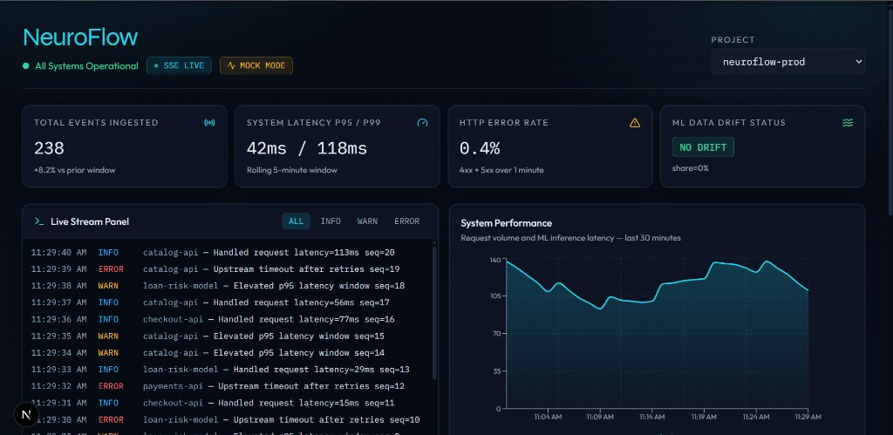
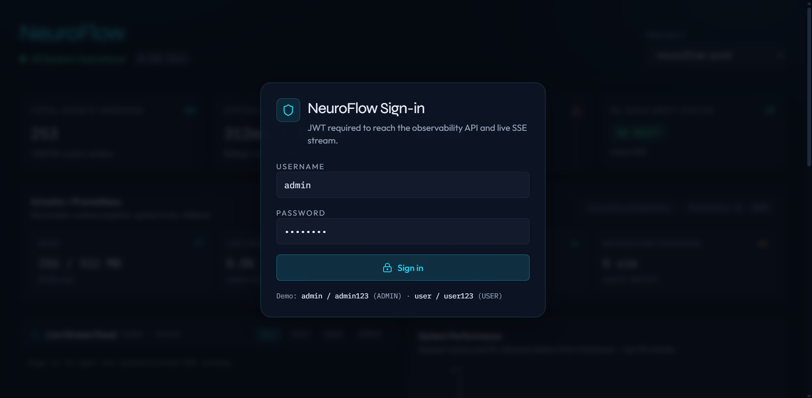
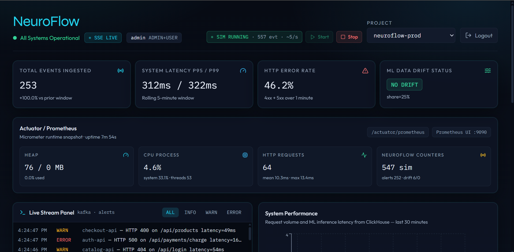
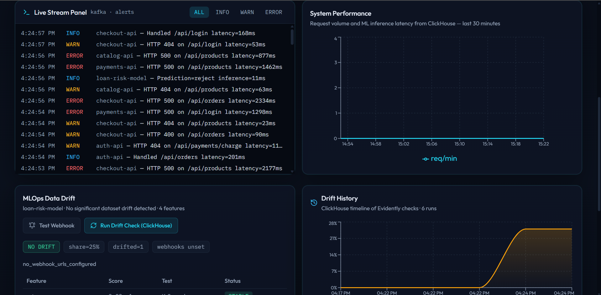
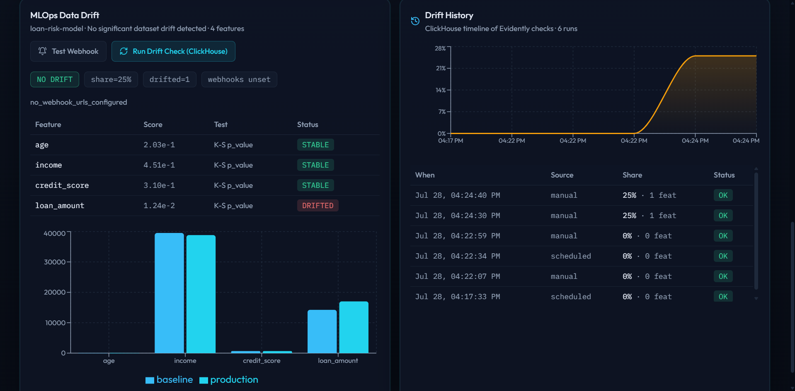

<div align="center">

# NeuroFlow

### Observabilité temps réel & monitoring MLOps event-driven

[](https://github.com/AyoubElKharraf/NeuroFlow/actions/workflows/ci.yml)
[](https://www.oracle.com/java/)
[](https://spring.io/projects/spring-boot)
[](https://kafka.apache.org/)
[](https://clickhouse.com/)
[](https://fastapi.tiangolo.com/)
[](https://www.evidentlyai.com/)
[](https://nextjs.org/)
[](https://docs.docker.com/compose/)
[](#licence)

**Kafka → Spring Boot → ClickHouse · Drift Evidently · Dashboard Next.js · Prometheus**

<br />

[](docs/demo.mp4)

*Cliquez l’image pour ouvrir la [démo vidéo](docs/demo.mp4) · ~24 Mo*

</div>

---

## Pourquoi NeuroFlow ?

Dans les architectures distribuées, deux signaux critiques restent souvent invisibles :

1. **La dégradation opérationnelle** — latence p95/p99, taux d’erreurs HTTP, saturation des services  
2. **La dérive silencieuse des modèles ML** (*data drift*) — les features production s’écartent de la baseline d’entraînement

**NeuroFlow** est une plateforme d’observabilité **event-driven** qui relie ces deux mondes : ingestion Kafka haute cadence, analytique ClickHouse, détection de drift Evidently, et un dashboard live (SSE) pour la démo et le monitoring.

> Ce n’est **pas** un projet EEG / neuroscience — le nom évoque le *flow* d’événements et de signaux MLOps.

---

## Démo en images

| Login JWT | Vue d’ensemble live |
|-----------|---------------------|
|  |  |

| Stream Kafka + performance ClickHouse | Drift Evidently + historique |
|---------------------------------------|------------------------------|
|  |  |

**[▶️ Télécharger / lire la démo vidéo (`docs/demo.mp4`)](docs/demo.mp4)**

### Script démo entretien (~60 s)

1. Ouvrir http://localhost:3000 → login `admin` / `admin123`
2. Cliquer **Start** → badge `SIM RUNNING`, KPI et compteurs Actuator bougent  
   - Optionnel : presets **Low / Med / High** pour le taux d’erreurs HTTP simulé  
3. Observer le **Live Stream** : WARN / ERROR issus du topic Kafka `alerts`  
4. **Run Drift Check (ClickHouse)** → features STABLE / DRIFTED + timeline historique  
5. (Optionnel) Ouvrir Grafana http://localhost:3001 → dashboard **NeuroFlow Runtime**  
6. (Optionnel) **Test Webhook** si Slack/Discord sont configurés → **Stop**

---

## Sommaire

1. [Architecture](#architecture)
2. [Fonctionnalités](#fonctionnalités)
3. [Stack technique](#stack-technique)
4. [Démarrage rapide (Docker)](#démarrage-rapide-docker)
5. [Credentials & URLs](#credentials--urls)
6. [Structure du repository](#structure-du-repository)
7. [API REST & SSE](#api-rest--sse)
8. [MLOps — drift & inférence](#mlops--drift--inférence)
9. [Webhooks Slack / Discord](#webhooks-slack--discord)
10. [Tests & CI](#tests--ci)
11. [Roadmap](#roadmap)
12. [Licence](#licence)

---

## Architecture

Pipeline **Event-Driven** : couplage faible, faible latence, stack entièrement orchestrée via Docker Compose.

```text
┌──────────────────────┐     ┌──────────────────────┐
│  Simulation / apps   │     │  loan-risk-model     │
│  (télémétrie HTTP)   │     │  (features + score)  │
└──────────┬───────────┘     └──────────┬───────────┘
           │                            │
           ▼                            ▼
┌─────────────────────────────────────────────────────┐
│              Apache Kafka (Confluent)               │
│   telemetry-events · ml-predictions · alerts        │
└──────────────────────────┬──────────────────────────┘
                           │ Spring Cloud Stream
                           ▼
┌─────────────────────────────────────────────────────┐
│         Spring Boot 3.3  (Java 21)                  │
│  Ingestion · JWT (Postgres) · Simulation ADMIN      │
│  SSE ← Kafka alerts · Micrometer / Prometheus       │
│  Client drift + webhooks Slack/Discord              │
└───────┬──────────────────┬────────────────┬─────────┘
        ▼                  ▼                ▼
┌───────────────┐  ┌──────────────┐  ┌──────────────────┐
│  ClickHouse   │  │  PostgreSQL  │  │ FastAPI          │
│  KPI · logs   │  │  app_users   │  │ Evidently drift  │
│  ML · history │  │              │  │ sklearn /predict │
└───────┬───────┘  └──────────────┘  └────────┬─────────┘
        │                                      │
        └──────────────────┬───────────────────┘
                           ▼
              ┌────────────────────────┐
              │  Next.js 15 Dashboard  │
              │  KPI · SSE · Drift UI  │
              └────────────────────────┘
```

---

## Fonctionnalités

| Capacité | Détail |
|----------|--------|
| **Ingestion event-driven** | Producteurs → Kafka → Spring Cloud Stream → ClickHouse |
| **KPI & charts live** | Événements, p95/p99, error rate, req/min — **agrégats ClickHouse** (pas de mocks hardcodés) |
| **Alertes SSE** | Stream branché sur le topic Kafka `alerts` (HTTP 4xx/5xx, latence, drift) |
| **Data Drift MLOps** | Evidently (K-S) sur `age`, `income`, `credit_score`, `loan_amount` + historique ClickHouse |
| **Inférence ML** | Modèle sklearn `loan-risk-model` via `POST /api/v1/predict` (appelé par la simulation) |
| **Simulation UI** | Start / Stop (rôle ADMIN) + presets error rate Low/Med/High + compteur d’événements |
| **Auth JWT** | Users en PostgreSQL (`admin` / `user`) + rôles Spring Security |
| **Observabilité JVM** | Actuator + Micrometer → Prometheus `:9090` + Grafana `:3001` |
| **Webhooks** | Slack / Discord sur détection de dataset drift (cooldown Redis) |
| **CI** | Testcontainers + pytest + build Next.js + Playwright smoke |

---

## Stack technique

| Couche | Technologies |
|--------|----------------|
| Backend | Java 21, Spring Boot 3.3, Spring Cloud Stream (Kafka), JPA, Redis, Micrometer |
| Analytique | ClickHouse 24.8, PostgreSQL 16 |
| MLOps | Python 3.11, FastAPI, Evidently, scikit-learn, Pandas |
| Frontend | Next.js 15, TypeScript, Tailwind, Recharts |
| Observabilité | Spring Actuator, Prometheus |
| Infra | Docker Compose (Zookeeper, Kafka, Postgres, ClickHouse, Redis, apps, Prometheus) |
| Qualité | GitHub Actions, Testcontainers, Maven, pytest, Playwright |

---

## Démarrage rapide (Docker)

### Prérequis

- **Docker Desktop** (WSL2 recommandé sous Windows)
- ~8 Go RAM alloués à Docker pour un build confortable

> Sous Windows, PostgreSQL est exposé sur le port hôte **5433** (`5432` est souvent déjà pris).

### Lancer toute la stack

```bash
git clone https://github.com/AyoubElKharraf/NeuroFlow.git
cd NeuroFlow
cp .env.example .env          # Windows: Copy-Item .env.example .env

docker compose up -d --build
docker compose ps
```

Premier build : **10–20 min** (Maven + deps Python Evidently + Next.js). Les relances suivantes sont beaucoup plus rapides :

```bash
docker compose up -d
```

Si un conflit de nom de conteneur apparaît (`Conflict … already in use`) :

```bash
docker compose down
docker compose up -d
```

### Alternative — apps en local (infra Docker)

```bash
docker compose up -d zookeeper kafka kafka-init postgres clickhouse redis

scripts\run-analytics.cmd    # :8001
scripts\run-backend.cmd      # :8080  (JDK 17+)
cd neuroflow-ui && npm install && npm run dev   # :3000
```

### Arrêt

```bash
docker compose down          # conserve les volumes
docker compose down -v       # wipe total des données
```

---

## Credentials & URLs

| Rôle | Identifiants |
|------|----------------|
| Admin (simulation, webhooks) | `admin` / `admin123` |
| User (lecture) | `user` / `user123` |

| URL | Service |
|-----|---------|
| http://localhost:3000 | Dashboard Next.js |
| http://localhost:8080/api/v1/health | Backend Spring Boot |
| http://localhost:8080/actuator/prometheus | Métriques Prometheus |
| http://localhost:8001/health | Analytics FastAPI |
| http://localhost:9090 | Prometheus UI |
| http://localhost:3001 | Grafana (admin / admin, dashboard NeuroFlow Runtime) |
| http://localhost:8123 | ClickHouse HTTP |

| Service Compose | Port hôte |
|-----------------|-----------|
| UI | `3000` |
| Backend | `8080` |
| Analytics | `8001` |
| Kafka | `9092` |
| PostgreSQL | `5433` |
| ClickHouse | `8123` / `9000` |
| Redis | `6379` |
| Prometheus | `9090` |
| Grafana | `3001` |
| Zookeeper | `2181` |

---

## Structure du repository

```text
NeuroFlow/
├── docs/
│   ├── dashboard.png              # Hero README
│   ├── dashboard-overview.png     # KPI + Actuator + sim
│   ├── dashboard-live-stream.png  # SSE + performance
│   ├── dashboard-drift.png        # Evidently + history
│   ├── dashboard-login.png        # Auth JWT
│   └── demo.mp4                   # Capture écran live
├── docker-compose.yml
├── docker/                        # Init Postgres / ClickHouse / Prometheus
├── .github/workflows/ci.yml
├── scripts/                       # Smoke tests Windows
├── neuroflow-backend/             # Spring Boot — ingestion, API, SSE
├── neuroflow-analytics/           # FastAPI — drift + predict
└── neuroflow-ui/                  # Next.js — dashboard
```

---

## API REST & SSE

### Backend (`:8080`)

| Méthode | Endpoint | Auth | Description |
|---------|----------|------|-------------|
| `GET` | `/api/v1/health` | public | Santé |
| `POST` | `/api/v1/auth/login` | public | Login JWT |
| `POST` | `/api/v1/simulation/start` | **ADMIN** | Démarre la simulation Kafka |
| `POST` | `/api/v1/simulation/stop` | **ADMIN** | Arrête la simulation |
| `POST` | `/api/v1/simulation/error-rate` | **ADMIN** | Cible le % d’erreurs HTTP simulées (`{ "errorRatePct": 15 }`) |
| `GET` | `/api/v1/simulation/status` | JWT | État simulation (+ `errorRatePct`) |
| `GET` | `/api/v1/metrics/kpis` | JWT | KPI dashboard (ClickHouse) |
| `GET` | `/api/v1/metrics/performance?minutes=30` | JWT | Séries req/min + latence ML |
| `GET` | `/api/v1/metrics/runtime` | JWT | Snapshot Micrometer (JVM / HTTP / counters) |
| `GET` | `/actuator/prometheus` | public | Exposition scrape Prometheus |
| `POST` | `/api/v1/analytics/drift/run` | JWT | Drift Evidently + persist historique |
| `GET` | `/api/v1/analytics/drift/history` | JWT | Timeline `drift_history` |
| `GET` | `/api/v1/analytics/webhooks/status` | JWT | Slack/Discord configurés ? |
| `POST` | `/api/v1/analytics/webhooks/test` | **ADMIN** | Message test webhook |
| `GET` | `/api/v1/alerts/stream` | JWT | **SSE** (`Authorization` ou `?token=`) |

```bash
curl -X POST http://localhost:8080/api/v1/auth/login \
  -H "Content-Type: application/json" \
  -d '{"username":"admin","password":"admin123"}'
```

### Analytics (`:8001`)

| Méthode | Endpoint | Description |
|---------|----------|-------------|
| `GET` | `/health` | Santé |
| `POST` | `/api/v1/drift/check` | Calcul data drift |
| `GET` | `/api/v1/drift/report-html` | Rapport Evidently HTML |
| `POST` | `/api/v1/predict` | Inférence `loan-risk-model` |
| `GET` | `/api/v1/predict/health` | Santé du modèle |

---

## MLOps — drift & inférence

Le service analytics compare un batch de features **production** (lues depuis ClickHouse `ml_predictions.features_json`) à une **baseline** d’entraînement via Evidently.

| Feature | Test |
|---------|------|
| `age` | Kolmogorov–Smirnov |
| `income` | Kolmogorov–Smirnov |
| `credit_score` | Kolmogorov–Smirnov |
| `loan_amount` | Kolmogorov–Smirnov |

Chaque run (manuel ou planifié) est persisté dans ClickHouse (`drift_history`) et affiché dans la timeline UI.

```bash
# Via le backend (chemin dashboard)
curl -X POST http://localhost:8080/api/v1/analytics/drift/run \
  -H "Authorization: Bearer <token>"
```

---

## Webhooks Slack / Discord

1. Créer un Incoming Webhook Slack et/ou Discord  
2. Renseigner dans `.env` :

```bash
SLACK_WEBHOOK_URL=https://hooks.slack.com/services/...
DISCORD_WEBHOOK_URL=https://discord.com/api/webhooks/.../...
WEBHOOK_COOLDOWN_SECONDS=300
```

3. `docker compose up -d backend`  
4. Dashboard (admin) → **Test Webhook**, ou attendre un vrai dataset drift  

Sans URL : le service reste silencieux (pas d’erreur).

---

## Tests & CI

```bat
scripts\test-phase5.cmd
```

| Job CI | Contenu |
|--------|---------|
| **Backend** | `mvn test` — Postgres, Kafka, Redis, ClickHouse (Testcontainers) |
| **Analytics** | `pytest` — health + drift normal / décalé |
| **UI** | `npm ci` + `next build` |

```bash
cd neuroflow-ui && npm run test:e2e
```

Pipeline : [`.github/workflows/ci.yml`](.github/workflows/ci.yml)

---

## Roadmap

- [x] Phase 1 — Docker Compose + scaffolding multi-modules  
- [x] Phase 2 — Ingestion Kafka → ClickHouse + API simulation  
- [x] Phase 3 — Moteur de drift Evidently + client Spring  
- [x] Phase 4 — Dashboard Next.js (SSE, charts, drift)  
- [x] Phase 5 — Testcontainers + GitHub Actions CI  
- [x] Phase 6 — KPI / charts / drift branchés sur ClickHouse  
- [x] Phase 7 — Contrôles simulation UI + Compose full-stack  
- [x] Phase 8 — Alertes SSE ← Kafka ; users Postgres ; modèle sklearn ; Playwright  
- [x] Phase 9 — Historique drift (ClickHouse + timeline UI)  
- [x] Phase 10 — Webhooks Slack / Discord  
- [x] Phase 11 — Actuator + Prometheus (dashboard + scrape Compose)  
- [x] Phase 12 — Grafana provisionné + polish démo (heap JVM, error-rate sim)  
- [ ] Concept drift / monitoring des labels  
- [ ] Durcissement prod (secrets, TLS, rate-limit API)

---

## Licence

Distribué sous licence [MIT](LICENSE).
